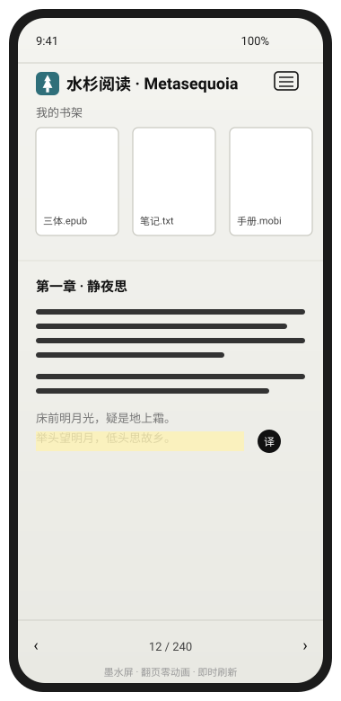

# 砚白 · Inkstone

<p align="center">
  
</p>

<p align="center">
  <a href="https://github.com/rayyang-dev/ink-reader/releases"></a>
  
  
  
</p>

**砚白（Inkstone）** 是一款面向「墨水屏阅读器 / 手机 / 平板」的本地优先电子书阅读应用。
它吸收了 KOReader、Moon+、Kindle、reMarkable、Neo Reader 的优点，解决传统方案的三大痛点：

- 排版与自定义差 → 提供克制的排版引擎与可调字体 / 边距 / 行距
- 翻页卡顿、残影严重 → **分页式阅读 + 翻页零动画 + 整屏反相刷新（Regal）**，贴合墨水屏特性
- 导入麻烦、广告多 → 纯本地、无广告、**App 内直接解析 MOBI**（无需 Calibre）

> 设计原则：**本地优先、零追踪、离线可用**。书籍与进度只存在你自己的设备上。

---

## ✨ 特性

- 📚 **多格式导入**：EPUB / PDF / TXT / MOBI，App 内原生解析，MOBI 无需借助 Calibre
- 📖 **分页式阅读**：非滚动，按屏幕真实分页，接近纸质书体验
- ⚡ **墨水屏友好**：翻页零动画、即时整屏刷新，规避残影与拖影
- 🔤 **中英互译**：划词即译，可选 Mock / DeepL / Google / 兼容 OpenAI 的 LLM 后端，密钥仅存本地，默认关闭
- 📱 **响应式 + PWA**：同一套界面适配手机 / 平板；可「添加到主屏幕」离线使用
- 💾 **本地存储**：书籍内容存 IndexedDB，设置 / 进度 / 书签存 localStorage（均带内存兜底）
- 🤖 **Android 原生壳**：基于 Capacitor，打包为 `com.inkreader.app`（应用名「砚白」）

---

## 📦 安装

### Android APK（推荐）

前往 **[Releases](https://github.com/rayyang-dev/ink-reader/releases)** 下载最新 `app-debug.apk`，
在手机上允许「未知来源」安装即可。无需登录、无后台联网。

### Web / PWA

直接用浏览器打开托管地址，或本地启动静态服务：

```bash
# 在本仓库 www/ 目录下起一个静态服务器即可
npx serve www
```

在手机浏览器中「添加到主屏幕」，即可获得类原生体验。

---

## 🛠 从源码构建（Android）

环境要求：**JDK 17+**、**Android SDK（platform 36 + build-tools 36.0.0）**、Node 22+。

```bash
# 1. 安装依赖
npm install

# 2. 同步 Web 资源到原生工程
npx cap sync android

# 3. 构建 Debug 包
cd android
./gradlew assembleDebug
# 产物：android/app/build/outputs/apk/debug/app-debug.apk
```

> 若 `JAVA_HOME` 指向了旧 JDK，请先修正，例如：
> `export JAVA_HOME="/c/Program Files/Java/jdk-18"`
> 安装 SDK 平台：`sdkmanager "platforms;android-36" "build-tools;36.0.0" "platform-tools"`

---

## 🌐 中英互译配置

默认关闭。在阅读页**选中一段文字**会浮出「译」按钮，点击后按配置的后端翻译。

设置项（存于 localStorage，不上传）：

| 配置 | 说明 |
|------|------|
| 翻译后端 | none / mock / DeepL / Google / LLM |
| API Key | 仅本地保存，默认空 |
| LLM Base | 兼容 OpenAI 的 `/v1` 地址，默认 `https://api.openai.com/v1` |
| LLM Model | 如 `gpt-4o-mini` |
| 方向 | 自动 / 中→英 / 英→中 |

`mock` 后端离线返回占位译文，可用于体验流程；真实翻译请填入对应后端 Key。

---

## 🧱 技术栈

- 前端：原生 ES Modules（无打包构建）、IndexedDB、Service Worker（PWA）
- 解析：[fflate](https://github.com/101arrowz/fflate)（EPUB）、[pdf.js v4](https://github.com/mozilla/pdf.js)（PDF）、自研 MOBI 解析器
- 原生壳：Capacitor 8（Android）
- 测试：Node 原生 `node:test`（解析 / 翻译 / 端到端共 5 套用例，全部通过）

---

## 📁 项目结构

```
ink-reader/
├── www/                  # Web 应用（PWA 入口，也是 Capacitor 的 webDir）
│   ├── index.html
│   ├── css/style.css
│   └── js/               # app / store / translate / mobidec 等模块
├── android/              # Capacitor 生成的 Android 原生工程
├── docs/mockup.svg       # 界面示意图
├── tests/                # 解析与翻译的单元 / 端到端测试
├── capacitor.config.json
└── README.md
```

---

## ✅ 测试

```bash
node --test tests/
```

覆盖 EPUB 管线、PDF 管线、MOBI 模块（含中文 124 章 / 英文 33 章解析）、
翻译后端路由，以及「MOBI 解析 → 取章 → 翻译」的端到端流程，全部通过。

---

## 📜 许可证

[MIT](LICENSE) —— 自由使用、修改与分发。
